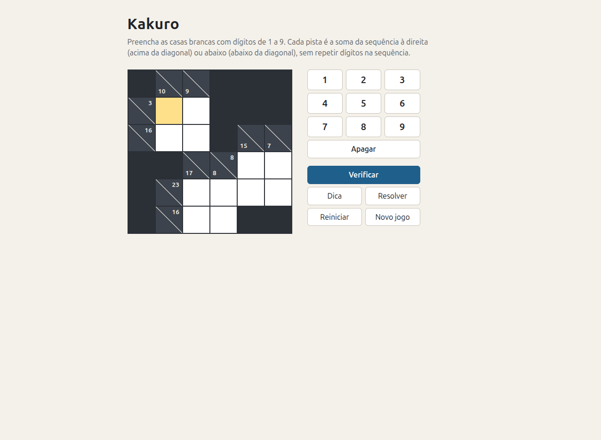

# Kakuro — Prolog, Python e Elm

## 1. Identificação

| Nome completo | Matrícula | Turma (14h/16h) | Usuário GitHub |
|---|---|---|---|
| Pedro Felipe Silva Vargas | 231039178 | 16h | @Pedrovargas10 |
| Davi dos Santos Brito Nobre | 211062929 | 14h | @Jagaima |
| Lucas Machado Peres Ricarte | 232014093 | 14h | @Lucas-Ricarte |
| Samuel Rodrigues Viana Lobo | 232014191 | 14h | @Samuelvlobo |
| Caio Rocha de Oliveira | 232001371 | 14h | @Dexmachi |
| Caio Soares de Andrade | 232014638 | 16h | @CaioSoandrd |
| Vitor Feijó Leonardo | 221008516 | 14h | @vitorfleonardo |

- **Nome do projeto:** Kakuro — Prolog, Python e Elm
- **Nome do grupo:** Equipe kakuro
- **Repositório:** https://github.com/Pedrovargas10/kakuro-paradigmas
- **Commit ou tag entregue:** `f98d0a418c4b77ecb5f0583a892931330bcedf35`
- **Ponto de partida:** outro jogo conhecido
- **Slides da apresentação oral:** [Apresentação no Google Slides](https://docs.google.com/presentation/d/1AdrMWySFHswIIYkz_onJeeLnjzmVzED9iBNA_wWmK3s/edit?usp=sharing)

## 2. Resumo

Kakuro é um quebra-cabeça de somas em uma grade 6×6. O jogador preenche as casas com dígitos de 1 a 9, sem repetição dentro de cada sequência, respeitando as pistas horizontais e verticais. O Prolog gera puzzles com solução única, verifica preenchimentos, encontra soluções e identifica dicas forçadas. A interface Elm permite jogar no navegador e usa uma API Python para consultar o motor lógico.




## 3. Como executar

**Requisitos**

- SWI-Prolog 9.2 ou superior no PATH.
- Python 3.12 ou superior, uv, compilador C e cabeçalhos de desenvolvimento para compilar Janus.
- Node.js 20 ou superior, npm e GNU Make. As versões exatas dos pacotes estão nos lockfiles.

**Instalação e execução**

```sh
git clone https://github.com/Pedrovargas10/kakuro-paradigmas.git
cd kakuro-paradigmas
make install
make dev
```

A interface abre em http://localhost:5173 e a API em http://127.0.0.1:8000/docs. O proxy Vite encaminha `/api` ao backend (`frontend/vite.config.js`). Para executar só a API, usar `make install-backend` e `make dev-backend`.

**Testes**

```sh
make test
cd frontend
npm run build
npx --no-install elm-format --validate src/ tests/
cd ..
make validar
```

Com a API já iniciada em outro terminal:

```sh
make test-integration PARTIDAS=10
```

**Testado em** Linux. O ensaio registrado em `docs/ENTREGA_PYTHON.md` usou contêiner Debian trixie, Python 3.13.5, SWI-Prolog 9.2.9 e Node 24.22.3. Os resultados e as limitações dessa execução estão na seção 8. As dependências são instaladas por `uv sync --locked` e `npm ci`, conforme o Makefile.

## 4. Arquitetura

```text
Navegador com Elm → HTTP/JSON → FastAPI em Python → Janus → SWI-Prolog
```

| Parte | Responsabilidade | Arquivos principais |
|---|---|---|
| Prolog | Restrições, busca de soluções, unicidade, geração e dicas | `backend/prolog/kakuro.pl`, `backend/prolog/generator.pl` |
| Elm | Domínio da interface, edição, seleção, feedback local e estado das requisições | `frontend/src/Kakuro.elm`, `frontend/src/Main.elm`, `frontend/src/Api.elm`, `frontend/src/View/` |
| Python | Validação do contrato HTTP, conversões, consultas parametrizadas ao Prolog e respostas de erro | `backend/app/schemas.py`, `backend/app/prolog.py`, `backend/app/main.py` |

As views recebem dados e mensagens. O módulo `Kakuro` concentra funções puras, `Api` trata a comunicação e `Main` coordena as mudanças de estado.

## 5. Parte em Prolog

### 5.1 Predicados principais

| Predicado | Local | O que faz |
|-----------|-------|-----------|
| `solution_count(+Puzzle, +Entradas, -N)` | [`backend/prolog/kakuro.pl:199`](backend/prolog/kakuro.pl#L199) | Conta soluções até o limite de 2 (`N` em `{0, 1, 2}`) usando `findnsols/4`, evitando enumerar todas as soluções |
| `solve(+Puzzle, +Entradas, -Solucao)` | [`backend/prolog/kakuro.pl:206`](backend/prolog/kakuro.pl#L206) | Monta as restrições CLP(FD) respeitando `Entradas` e resolve com `labeling([ff], AllVars)`; falha se não houver solução |
| `check(+Puzzle, +Entradas, -Estado)` | [`backend/prolog/kakuro.pl:225`](backend/prolog/kakuro.pl#L225) | Verifica se as entradas cobrem todas as casas brancas e se há solução compatível, devolvendo `"solved"`, `"incomplete"` ou `"inconsistent"` |
| `hint(+Puzzle, +Entradas, -Resultado)` | [`backend/prolog/kakuro.pl:239`](backend/prolog/kakuro.pl#L239) | Devolve `["hint", L, C, V]` apenas para casa vazia sem solução alternativa; trata `"complete"`, `"inconsistent"` e `"no_forced_hint"` |
| `setup(+Puzzle, +Entradas, -VarMap, -AllVars)` | [`backend/prolog/kakuro.pl:129`](backend/prolog/kakuro.pl#L129) | Normaliza e valida a grade 6×6, cria uma variável FD (`1..9`) por casa branca, aplica entradas e posta as restrições de cada sequência |
| `generate(-Puzzle)` / `generate(+Seed, -Puzzle)` | [`backend/prolog/generator.pl:22`](backend/prolog/generator.pl#L22) | Gera um puzzle 6×6 aleatório (ou determinístico via `Seed`) com solução única verificada por `solution_count/3`, com limite de 10 s |
| `generate_with_solution(-Puzzle, -Solution)` | [`backend/prolog/generator.pl:29`](backend/prolog/generator.pl#L29) | Gera o puzzle 6×6 junto com a lista de respostas `[Linha, Coluna, Valor]` |

### 5.2 Conceitos do paradigma lógico utilizados

- [x] Unificação e casamento de padrões: conversão de células em `normalize_cell/2` (`backend/prolog/kakuro.pl:15-24`), extração de pistas direcionais em `clue_value/3` e `make_pos/4` (`backend/prolog/kakuro.pl:94-98`) e montagem das células em `puzzle_cell/4` (`backend/prolog/generator.pl:174-176`).
- [x] Recursão (inclusive sobre listas): varredura de linhas e colunas em `dir_seqs/4`, `line_seqs/5` e `collect_whites/7` (`backend/prolog/kakuro.pl:60-92`), aplicação das entradas em `apply_entries/3` (`backend/prolog/kakuro.pl:169-183`) e rotulagem aleatória em `random_bits/1` e `random_labeling/1` (`backend/prolog/generator.pl:88-92`, `141-146`).
- [x] Backtracking e múltiplas soluções: busca de soluções em `solve/3` (`backend/prolog/kakuro.pl:206-209`), tentativa de novas máscaras e preenchimentos via `repeat` e `between(1, 20, _)` em `try_generate/2` (`backend/prolog/generator.pl:35-46`) e teste de alternativa em `alternative_exists/5` (`backend/prolog/kakuro.pl:263-266`).
- [x] `findall/3`, `bagof/3`, `setof/3` ou similares: `findnsols/4` em `solution_count/3` (`backend/prolog/kakuro.pl:200`) para interromper a busca na segunda solução; `findall/3` em `seq_positions/2` (`backend/prolog/kakuro.pl:152-153`) e `grid_solution/2` (`backend/prolog/generator.pl:178-183`).
- [x] Corte (`!`) ou negação (`\+`), e por que foram necessários: corte `!` em `normalize_cell/2`, `lookup/3` e `try_generate/2` (`backend/prolog/generator.pl:46`) para tornar determinísticas a normalização/busca em mapa e encerrar o `repeat` ao obter solução única; negação por falha `\+` em `first_forced/5` (`backend/prolog/kakuro.pl:256-257`) para aceitar uma dica apenas quando não existe solução com outro valor naquela casa.
- [x] Programação por restrições (CLP(FD) ou outra): `library(clpfd)` em `setup/4` e `post_constraints/2` (`backend/prolog/kakuro.pl:129-138`, `185-190`) com `ins 1..9`, `all_distinct/1`, `sum/3`, `#=` e `#\=`; e no gerador (`backend/prolog/generator.pl:67-85`, `127-129`) para garantir 8 a 12 casas brancas sem células isoladas.
- [x] Predicados de ordem superior (`maplist`, `foldl`, `include`): `maplist` em `normalize_puzzle/2` (`backend/prolog/kakuro.pl:30`), `transp/2` (`backend/prolog/kakuro.pl:40`), `post_constraints/2` (`backend/prolog/kakuro.pl:187`), `grid_clues/2` (`backend/prolog/generator.pl:159-163`) e `attempts_average/2` (`backend/prolog/generator.pl:51`).

### 5.3 Trecho em destaque

```prolog
% backend/prolog/kakuro.pl:129-138 e 185-190
setup(Puzzle, Entradas, VarMap, AllVars) :-
    normalize_puzzle(Puzzle, NPuzzle),
    white_positions(NPuzzle, Positions),
    sequences(NPuzzle, HSeqs, VSeqs),
    validate_white_coverage(Positions, HSeqs, VSeqs),
    append(HSeqs, VSeqs, Seqs),
    make_varmap(Positions, VarMap, AllVars),
    AllVars ins 1..9,
    apply_entries(Entradas, VarMap),
    post_constraints(Seqs, VarMap).

post_constraints([], _).
post_constraints([seq(Clue, Cells)|Seqs], Map) :-
    maplist(lookup_in(Map), Cells, Vars),
    all_distinct(Vars),
    sum(Vars, #=, Clue),
    post_constraints(Seqs, Map).
```

Em vez de implementar um algoritmo passo a passo (com laços testando números e desfazendo jogadas manualmente), o trecho acima declara **o que** precisa ser verdadeiro para que um tabuleiro seja um Kakuro válido:

1. **Preparação e validação (`setup/4`):** `normalize_puzzle/2` converte as células recebidas para o formato interno e valida a grade 6×6. Em seguida, `white_positions/2` lista todas as coordenadas brancas, `sequences/3` agrupa as casas de cada pista horizontal e vertical, e `validate_white_coverage/3` garante que nenhuma casa branca fique isolada sem pertencer às duas direções.
2. **Caixas vazias e compartilhamento nos cruzamentos (`make_varmap/3`):** para cada coordenada `pos(L, C)`, o Prolog cria uma variável lógica ainda sem número e guarda o par `pos(L, C)-Var` em `VarMap`. Com `AllVars ins 1..9`, todas recebem o domínio de 1 a 9, e `apply_entries/2` fixa os dígitos já preenchidos pelo jogador (`Var #= Val`).
3. **Regras por sequência (`post_constraints/2`):** para cada sequência `seq(Clue, Cells)`, `maplist(lookup_in(Map), Cells, Vars)` troca as coordenadas pelas suas variáveis em `VarMap`. Como uma casa no cruzamento aparece tanto em uma sequência horizontal quanto em uma vertical, **a mesma variável lógica participa das duas listas** — qualquer redução de possibilidades em uma linha reflete imediatamente na coluna, sem cópia de dados. Em seguida, `all_distinct(Vars)` proíbe dígitos repetidos na sequência e `sum(Vars, #=, Clue)` exige que a soma seja igual à pista.
4. **Propagação antes da busca:** ao declarar essas restrições, o motor CLP(FD) já elimina valores impossíveis dos domínios antes mesmo de testar qualquer chute. Só depois disso predicados como `solve/3` e `check/3` chamam `labeling([ff], AllVars)`, que escolhe primeiro a variável com menos opções restantes (*first-fail*) e usa *backtracking* caso algum caminho leve a contradição.
5. **Dica sem chutes (`hint/3`):** seguindo a mesma lógica declarativa (`backend/prolog/kakuro.pl:239-266`), o sistema encontra uma solução candidata e, para cada casa vazia com valor `V`, testa se ainda existe solução com `X #\= V`. Se essa alternativa falhar, o valor é logicamente forçado e pode ser revelado ao jogador.

## 6. Parte em Elm

### 6.1 Modelo e mensagens

O estado da aplicação fica em `frontend/src/Main.elm:24-77`. Os tipos centrais são:

```elm
type Model
    = Loading
    | LoadFailed Api.Error
    | InGame Game

type alias Game =
    { board : Board
    , selection : Maybe Editable
    , phase : Phase
    , notice : Notice
    }

type Phase
    = Ready Stage
    | Waiting Request Stage

type Stage
    = Playing
    | Finished

type Request
    = Generating
    | Checking
    | Hinting
    | Solving

type Notice
    = Quiet
    | Checked Api.CheckState
    | Hinted Api.HintResult
    | SolutionRevealed
    | Failed Request Api.Error

type Msg
    = NewGame
    | GotPuzzle (Result Api.Error Board)
    | SelectCell Position
    | PressDigit Digit
    | Erase
    | Move Direction
    | Reset
    | Check
    | GotCheck (Result Api.Error Api.CheckState)
    | AskHint
    | GotHint (Result Api.Error Api.HintResult)
    | Solve
    | GotSolution (Result Api.Error (List Entry))
    | Retry Request
```

Os tipos do domínio ficam em `frontend/src/Kakuro.elm`: `Digit`, `Sums`, `Cell`, `Board`, `Editable`, `Entry` e `Direction`. Os tipos da comunicação com o backend ficam em `frontend/src/Api.elm`: `Error`, `CheckState` e `HintResult`.

**Explicação das escolhas**

- **Fases do programa como tipo.** `Model` separa três situações: carregando o primeiro puzzle (`Loading`), falha ao carregá-lo (`LoadFailed`) e partida em andamento (`InGame`). Assim a tela de jogo nunca existe sem tabuleiro. Não há um `board : Maybe Board` espalhado pelo código.
- **`Phase` impede requisições simultâneas.** `Ready Stage` significa que o jogo aguarda o jogador. `Waiting Request Stage` significa que há uma chamada à API em andamento e guarda qual é e em que estágio o jogo estava (`Playing` ou `Finished`). Enquanto está em `Waiting`, os botões ficam desabilitados e os cliques repetidos são ignorados. Depois que a resposta chega, o jogo volta ao estágio em que estava.
- **`Notice` guarda o que a tela deve mostrar.** O texto exibido é calculado na `view` a partir de `Notice`, em vez de ser guardado como `String` no modelo. Mudar a mensagem ou o idioma mexe só nas funções de texto da `view` (`waitingText`, `noticeStatus`, `checkStatus`, `hintStatus` e `failureStatus`).
- **Uma mensagem para cada ação e uma para cada resposta.** Toda chamada ao backend tem uma mensagem de ida (`Check`, `AskHint`, `Solve`, `NewGame`) e uma de volta (`GotCheck`, `GotHint`, `GotSolution`, `GotPuzzle`). A resposta chega como `Result Api.Error a`, então sucesso e falha são tratados no `update`.
- **Tipos opacos no domínio.** `Digit` só pode ser criado por `digitFromInt` (aceita de 1 a 9). `Editable` só pode ser criado por `editableAt` ou `firstEditable`, que garantem que a casa selecionada é jogável. `Board` só pode ser criado por `fromRows`, que valida o formato 6×6. Estados inválidos (dígito 0 ou 12, seleção em casa de pista, tabuleiro 5×7) não podem ser construídos fora do módulo `Kakuro`.
- **O front-end não conhece a solução.** O tabuleiro só guarda os dígitos que o jogador digitou. Verificar, pedir dica e resolver passam sempre pelo backend em Prolog. O Elm só valida o que consegue sem a solução: dígitos repetidos, somas que já passaram da pista e sequências completas com soma diferente da pista (`conflicts`, `frontend/src/Kakuro.elm:382`).

### 6.2 Conceitos do paradigma funcional utilizados

- [x] Arquitetura Elm (Model, update, view): `Browser.element` (`frontend/src/Main.elm:14-21`) liga `init`, `update`, `subscriptions` e `view`. O `update` (`frontend/src/Main.elm:89-96`) só escolhe o caminho: `updateGame` quando o modelo é `InGame` e `updateLoading` nos outros casos. A `view` (`frontend/src/Main.elm:388-393`) é uma função pura do modelo para HTML. A tela nunca é alterada diretamente.
- [x] Custom types e `case` exaustivo: `Model`, `Phase`, `Request`, `Notice` e `Msg` (`frontend/src/Main.elm:24-77`). `Sums` (`AcrossOnly | DownOnly | AcrossAndDown`) e `Cell` (`Block | Clue | Playable`) (`frontend/src/Kakuro.elm:59`, `120`). `Api.Error`, `CheckState` e `HintResult` (`frontend/src/Api.elm:25-44`). Funções como `describeError` e `isTransient` (`frontend/src/Api.elm:47-88`), `waitingText`, `checkStatus` e `hintStatus` (`frontend/src/Main.elm:470`, `505`, `518`) listam todos os casos. Se alguém adicionar uma variante nova, o compilador aponta cada `case` que precisa ser atualizado.
- [x] `Maybe` e `Result` no lugar de null e exceções:
  - `Kakuro.digitFromInt : Int -> Maybe Digit` e `Kakuro.sums : Maybe Int -> Maybe Int -> Maybe Sums` (`frontend/src/Kakuro.elm:40`, `65`).
  - `cellAt` devolve `Maybe Cell` para posições fora da grade (`frontend/src/Kakuro.elm:162`).
  - `fromRows : List (List Cell) -> Result String Board` rejeita um tabuleiro malformado com uma mensagem (`frontend/src/Kakuro.elm:135`).
  - Todas as chamadas HTTP devolvem `Result Api.Error a` (`readResponse`, `frontend/src/Api.elm:124`).
  - `Maybe Editable` em `selection` representa "nenhuma casa selecionada".
  - `encodeSum` e `sumsDecoder` convertem `Maybe Int` em `null` do JSON e vice-versa (`frontend/src/Api.elm:196`, `269`).
- [x] Funções de ordem superior e aplicação parcial:
  - `List.foldl fillIfEmpty board solution` em `fillEmptyCells` (`frontend/src/Kakuro.elm:315`).
  - `List.foldl (\position -> setDigit position Nothing) board ...` em `reset` (`frontend/src/Kakuro.elm:301`).
  - `place` e `clear` recebem só parte dos argumentos e devolvem uma função `Board -> Board` (`frontend/src/Kakuro.elm:289`, `294`). É por isso que `edit (\cell -> Kakuro.place cell digit) game` e `edit Kakuro.clear game` funcionam com a mesma função `edit` (`frontend/src/Main.elm:122`, `125`).
  - `Maybe.map (Entry position)` aplica parcialmente o construtor do record `Entry` (`frontend/src/Kakuro.elm:285`).
  - `Decode.map2 Kakuro.sums`, `Decode.map3 toEntry` (`frontend/src/Api.elm:271`, `279`) e `Decode.map4 keyPress` (`frontend/src/Main.elm:336`).
  - `List.filterMap`, `List.concatMap` e `List.indexedMap` nos cálculos do tabuleiro.
- [x] Composição (`|>`, `>>`):
  - Pipelines em `keyToMsg`: `String.toInt key |> Maybe.andThen Kakuro.digitFromInt |> Maybe.map PressDigit` (`frontend/src/Main.elm:383-385`).
  - Composição com `>>` em `Result.mapError (Decode.errorToString >> UnexpectedResponse)` (`frontend/src/Api.elm:129`), `Tuple.second >> isPlayable` (`frontend/src/Kakuro.elm:191`), `.digit >> digitToInt` (`frontend/src/Kakuro.elm:396`) e `Kakuro.fromRows >> fromResult` (`frontend/src/Api.elm:244`).
- [x] Decoders e encoders JSON:
  - `encodeGame`, `encodePuzzle`, `encodeCell`, `encodeEntry` e `encodeSum` montam o JSON enviado ao backend, seguindo o contrato (`kind`, `across`, `down`, `row`, `col`, `value`) (`frontend/src/Api.elm:160-216`).
  - `boardDecoder`, `cellDecoder`, `sumsDecoder`, `entryDecoder`, `checkDecoder`, `hintDecoder` e `solveDecoder` leem as respostas (`frontend/src/Api.elm:219-324`).
  - `Decode.andThen` encadeia um campo discriminador (`kind`, `state`) com a escolha do decoder seguinte. `fromResult` e `fromMaybe` (`frontend/src/Api.elm:327-344`) transformam `Result` e `Maybe` em decoders que falham com mensagem clara. Assim uma resposta fora do contrato vira `UnexpectedResponse` em vez de quebrar o programa.
- [x] Comandos e subscriptions (efeitos controlados):
  - `Api.generate`, `Api.check`, `Api.hint` e `Api.solve` devolvem `Cmd msg`. Todas passam por `post`, que usa `Http.request` com `timeout` de 30 s (`frontend/src/Api.elm:111`).
  - `init` já dispara `Api.generate GotPuzzle` (`frontend/src/Main.elm:17`).
  - `subscriptions` usa `Browser.Events.onKeyDown` só quando o modelo é `InGame`, para o jogador usar teclado (setas, dígitos de 1 a 9, Backspace e Delete). Em `Loading` ou `LoadFailed` não há subscription (`Sub.none`) (`frontend/src/Main.elm:324`).
  - `readResponse` e `errorFromStatus` traduzem a resposta HTTP para `Api.Error`: 422 vira `Rejected`, 503 vira `Unavailable`, outros erros com `detail` viram `ServerFailure`, timeout vira `TimedOut` e falha de rede vira `Unreachable` (`frontend/src/Api.elm:124`, `144`).
- [x] Imutabilidade e atualização de records: toda mudança de estado cria um valor novo, como em `{ game | selection = Just cell }`, `{ game | board = change cell game.board, notice = Quiet }` e `{ game | phase = Ready Finished, notice = notice }` (`frontend/src/Main.elm:165`, `180`, `316`). O tabuleiro usa `Array` e `updateAt` para trocar uma casa sem alterar o tabuleiro anterior (`frontend/src/Kakuro.elm:332`).
- [x] Outro:
  - Recursão em `nextPlayable` e `playableRun`, que percorrem o tabuleiro numa direção até achar uma casa jogável ou o fim da grade (`frontend/src/Kakuro.elm:254`, `368`).
  - Casamento de padrão em tuplas, como `case ( status, Decode.decodeString ... )` em `errorFromStatus` (`frontend/src/Api.elm:146`) e `( game.phase, game.selection )` em `edit` (`frontend/src/Main.elm:178`).
  - `Set Position` em `conflicts`, que remove posições repetidas (`frontend/src/Kakuro.elm:382`).
  - Separação entre módulos de lógica (`Kakuro`), comunicação (`Api`) e apresentação (`View.Board`, `View.Controls`).

### 6.3 Trecho em destaque

Trecho de `frontend/src/Main.elm:205-256`: a máquina de estados que controla as requisições.

```elm
canStart : Request -> Phase -> Bool
canStart request phase =
    case request of
        Generating ->
            isReady phase

        _ ->
            phase == Ready Playing


start : Request -> Game -> ( Game, Cmd Msg )
start request game =
    case game.phase of
        Ready stage ->
            if canStart request game.phase then
                ( { game | phase = Waiting request stage }, send request game.board )

            else
                ( game, Cmd.none )

        Waiting _ _ ->
            ( game, Cmd.none )


send : Request -> Board -> Cmd Msg
send request board =
    case request of
        Generating ->
            Api.generate GotPuzzle

        Checking ->
            Api.check GotCheck board

        Hinting ->
            Api.hint GotHint board

        Solving ->
            Api.solve GotSolution board


receive : Request -> (Game -> Game) -> Game -> Game
receive expected apply game =
    case game.phase of
        Waiting pending stage ->
            if pending == expected then
                apply { game | phase = Ready stage }

            else
                game

        Ready _ ->
            game
```

**Como funciona.** As quatro operações que dependem do servidor (gerar, verificar, pedir dica e resolver) passam pelo mesmo caminho.

1. `start` só aceita um pedido se o jogo estiver em `Ready`. Se aceitar, muda a fase para `Waiting request stage` e dispara o `Cmd` correspondente, escolhido por `send`. Se já estiver `Waiting`, não faz nada e devolve `Cmd.none`.
2. `canStart` aplica a regra do jogo. Verificar, pedir dica e resolver só valem durante a partida (`Ready Playing`), então não é possível pedir dica depois de o puzzle ter sido resolvido. Gerar um puzzle novo vale em qualquer fase `Ready`, inclusive em `Finished`.
3. Quando a resposta chega, `receive` confere se a mensagem corresponde ao pedido que estava pendente (`pending == expected`). Se corresponder, volta a fase para `Ready stage` e aplica o resultado com a função `apply` (`applyCheck`, `applyHint`, `applySolution` ou `applyPuzzle`). Se não, ignora a resposta.
4. `controlsFor` usa a mesma `canStart` para habilitar ou desabilitar os botões. Por isso a regra que a interface mostra e a regra que o `update` aplica são sempre a mesma.

Nos testes manuais, clicar várias vezes em "Verificar" ou apertar "Dica" durante outra requisição não gerava chamadas duplicadas nem respostas misturadas. Isso acontece sem flags booleanas nem contadores, só porque `Phase` é um tipo cujo estado inválido não consegue ser construído.

## 7. Integração

O Python conecta a interface Elm ao motor Prolog. Ele recebe o tabuleiro e os números preenchidos pelo jogador, valida os dados e consulta o Prolog por meio do Janus. A resposta volta ao Elm para atualizar a tela.

| Rota | Corpo da requisição | Resposta HTTP 200 | Consulta Prolog |
|---|---|---|---|
| `/api/generate` | `{}` | Objeto `puzzle` com a grade, sem os dígitos da solução | `generator:generate/1` |
| `/api/check` | Objeto `puzzle` e lista `entries` | Campo `state` com incomplete, inconsistent ou solved | `kakuro:check/3` |
| `/api/solve` | Objeto `puzzle` e lista `entries` | Campo `solution` com todas as casas resolvidas, respeitando as entradas | `kakuro:solve/3` |
| `/api/hint` | Objeto `puzzle` e lista `entries` | Campos `kind`, `row`, `col`, `value` para uma dica, ou `kind` com complete, inconsistent ou no_forced_hint | `kakuro:hint/3` |

As rotas estão em `backend/app/main.py` e a comunicação com o Prolog em `backend/app/prolog.py`. O Prolog decide as regras, as soluções e as dicas. O Python adapta os dados e devolve mensagens de erro quando necessário, inclusive se a geração ultrapassar o limite de dez segundos. Dica e resolução preservam os números já preenchidos pelo jogador.

A integração é conferida pelos testes da API e pelo comando `make test-integration PARTIDAS=10`. O roteiro e os exemplos de uso estão em `docs/API_PYTHON.md`; os resultados estão na seção 8.

## 8. Testes e validação

A validação do projeto combina testes automatizados com conferências da aplicação em funcionamento. Foram usados puzzles fixos com solução conhecida para verificar se o sistema reconhece uma partida incompleta, identifica um preenchimento incompatível e aceita uma solução correta. Também foram testadas a preservação dos números digitados pelo jogador e a aplicação da dica na casa vazia correta.

Na parte Python, os testes verificam as quatro operações da API e sua comunicação real com o Prolog. Foram considerados casos como valores fora de 1 a 9, posições repetidas e tentativas de preencher casas de pista ou bloqueio. Na versão atual, passam os 48 testes Prolog (`make test-prolog`), os 113 testes Python (`make test-backend`) e os 43 testes Elm (`make test-frontend`). Os testes Prolog verificam as regras, as soluções e a geração dos puzzles. No Elm, os testes cobrem as operações do tabuleiro e a leitura e escrita dos dados trocados com a API.

A comunicação entre as partes também foi exercitada em dez partidas consecutivas, passando por geração, verificação, dica, resolução e conclusão. Nessa amostra, a geração levou em média 3,374 segundos e no máximo 7,312 segundos. A instalação e a inicialização foram conferidas em um ambiente Linux limpo em 18/11; naquela versão, 39 dos 40 testes Prolog passaram, com uma falha no teste de várias gerações seguidas.

A primeira conferência no navegador incluiu dica, resolução e recuperação após falha de comunicação, e houve uma falha de geração no quinto novo jogo, quando o tempo limite foi atingido. A conferência de 23/11, registrada em `docs/VALIDACAO_FLUXO.md`, repetiu todos os critérios da issue #29: dez gerações seguidas sem falha (média de 1,4 s e máximo de 4,0 s), teclado, bloqueio dos controles durante as requisições e recuperação depois de desligar e religar o backend.

O relatório é conferido pelo validador oficial do professor. Ele identifica campos pendentes, problemas de formatação e referências a arquivos inexistentes. Na versão atual, `make validar` termina sem erros.

## 9. Limitações e problemas conhecidos

**Problemas conhecidos**

- **A geração funciona por tentativa e erro, e o tempo varia.** O gerador sorteia uma máscara e um preenchimento e só aceita o puzzle quando `solution_count/3` encontra uma única solução (`backend/prolog/generator.pl:35-46`). Em 40 gerações medidas diretamente no Prolog, todas terminaram, com média de 1,1 s e máximo de 3,5 s, mas cada puzzle aceito precisou, em média, de 134 preenchimentos sorteados (até 442). Pela API, a geração já levou até 7,3 s, e na primeira conferência no navegador uma delas passou do limite de 10 s e voltou como HTTP 503 (seção 8). A interface mostra a falha e oferece "Tentar de novo", mas o jogador precisa esperar e repetir.
- **O teste de várias gerações depende da velocidade da máquina.** `generator:varias_geracoes` (`backend/prolog/test_kakuro.pl:430`) gera dez puzzles com sementes fixas, mas cada geração continua sujeita ao limite de 10 s. Por isso ele passa nas nossas máquinas e já falhou uma vez no contêiner Linux limpo (seção 8).
- **Os puzzles são pequenos e não têm nível de dificuldade.** A máscara sempre deixa a primeira linha e a primeira coluna pretas e tem de 8 a 12 casas brancas (`backend/prolog/generator.pl:60-75`). Assim, só parte do tabuleiro 6×6 é usada e as partidas são curtas.
- **`make dev` só funciona em Linux e macOS.** O alvo usa `os.setpgid`, `ps` e `kill` em grupos de processos (`Makefile`, linhas 17 e 22-96), que não existem no Windows. Nesse caso, o backend precisa rodar no WSL e o frontend em outro terminal, como descreve o `README.md`.
- **A instalação exige compilar o Janus.** O `backend/pyproject.toml` força a compilação do `janus-swi` a partir do código-fonte, o que pede um compilador C e os cabeçalhos do Python e do SWI-Prolog.
- **Só existe o modo de desenvolvimento.** O encaminhamento de `/api` ao backend está apenas no servidor do Vite (`frontend/vite.config.js`), e o FastAPI não serve os arquivos do frontend, então o resultado de `npm run build` não funciona sozinho. A API também aceita requisições de qualquer origem (`allow_origins=["*"]`, `backend/app/main.py:41`), o que só é adequado para uso local.
- **A partida não é salva.** O estado fica só na memória do Elm: recarregar a página descarta o puzzle e o preenchimento.
- **As setas podem rolar a página.** O teclado é lido por `Browser.Events.onKeyDown` (`frontend/src/Main.elm:328`), que não bloqueia o comportamento padrão do navegador. Em telas pequenas, em que a página tem rolagem, as setas movem a seleção e também rolam a página.
- **Os testes do Elm cobrem só o domínio e a API.** Os 43 testes verificam os módulos `Kakuro` e `Api`. O `update` e as telas foram conferidos apenas no navegador (seção 8 e `docs/VALIDACAO_FLUXO.md`).

**O que faríamos com mais tempo**

- Trocar o sorteio com descarte por uma geração mais dirigida, escolhendo primeiro pistas com poucas combinações possíveis, e medir o ganho com `attempts_average/2` (`backend/prolog/generator.pl:49`) e sementes reproduzíveis, sem abrir mão da checagem de unicidade.
- Separar o teste de várias gerações do limite de tempo, para que o resultado não dependa da máquina.
- Gerar tabuleiros com mais casas brancas e classificar a dificuldade, por exemplo, pela quantidade de dicas forçadas necessárias para resolver.
- Substituir o `make dev` por um script que também funcione no Windows e fazer o FastAPI servir o build do frontend.
- Salvar a partida no navegador e escrever testes para o `update` do Elm.

## 10. Contribuição de cada integrante

| Integrante | Principais contribuições |
|------------|--------------------------|
| Pedro Felipe Silva Vargas | Responsável pela infraestrutura do backend, ponte de geração/verificação, rotas generate/check, seus testes e documentação. |
| Caio Soares de Andrade | Modelos compartilhados, ponte e rotas solve/hint (#33/#34), Makefile e alvos do backend (#30/#51), guarda do validador (#46), README/.gitignore (#52), ampliação do verificador HTTP (#50), suíte solve/hint com fixtures (#55), revisão assistida dos PRs Python de Pedro e documentação de integração (#42). Evidências: PRs #30, #33, #34, #42, #46, #50, #51, #52 e #55. |
| Davi Nobre | Implementação inicial do motor lógico em `backend/prolog/kakuro.pl` (normalização, extração de sequências, restrições CLP(FD), `solution_count/3`, `solve/3`, `check/3`, `hint/3`), criação da suíte inicial de testes `plunit` em `backend/prolog/test_kakuro.pl`, criação dos puzzles de referência em `docs/fixtures/` (JSON e Prolog) e correções do PR #49 (cobertura das entradas em `check/3` e `hint/3`, busca limitada com `findnsols/4` e busca de alternativa em `hint/3`). |
| Lucas Machado Peres Ricarte | Implementação do gerador de puzzles em `backend/prolog/generator.pl` (`generate/1`, `generate/2` com semente, `generate_with_solution/2`, máscaras com CLP(FD), cálculo das pistas e checagem de solução única com `solution_count/3`), contagem de tentativas com `attempts_average/2` e criação dos testes `plunit` do gerador em `backend/prolog/test_kakuro.pl`. Evidências: PRs #43 e #48. |
| Samuel Rodrigues Viana Lobo | Infraestrutura do frontend em Elm (issue #7): criação do projeto em `frontend/` com Vite e `vite-plugin-elm`, incluindo `package.json` com os scripts `dev`, `build` e `preview`, `vite.config.js`, `index.html`, `src/main.js` e um `src/Main.elm` mínimo com `Browser.element`, além do `elm.json` gerado com as dependências `elm/http` e `elm/json`. Configuração do proxy do Vite para encaminhar `/api` ao backend FastAPI (ajustado para `127.0.0.1` após sugestão de revisão, evitando problemas de resolução IPv6), verificação de formatação com `elm-format`, abertura do PR com `Closes #7` e resolução do conflito de merge no `.gitignore` com a `main`. Também contribuiu na estruturação do plano de execução e na criação e organização das issues no GitHub (etiquetas, milestones por fase e divisão das tarefas entre as áreas Prolog, Python e Elm) e na montagem do quadro do projeto para acompanhamento. Evidências: issue #7 e PR #N. |
| Caio Rocha de Oliveira | Validações estruturais do puzzle e das entradas em `backend/prolog/kakuro.pl`, otimização de `hint/3`, unificação da extração de sequências horizontais e verticais, adição de testes `plunit` em `backend/prolog/test_kakuro.pl`. |
| Vitor Feijó Leonardo | Fiquei responsável pela interface em Elm. Parti da estrutura que o Samuel montou e fui construindo o frontend em camadas: primeiro o domínio do tabuleiro (`Kakuro.elm`), depois a comunicação com a API (`Api.elm`), as telas (`View/`) e, por último, o estado do jogo (`Main.elm`). Usei o Claude Code como apoio para escrever e refatorar esse código: eu definia o que cada parte precisava fazer, lia e revisava o resultado e testava no navegador contra o backend real até o comportamento bater com o contrato do grupo. Também adicionei os testes Elm (`frontend/tests/`) e integrei os PRs #54 e #57. Evidências: issues #17 a #28 e PRs #54 e #57. |

## 11. Fontes, código de terceiros e uso de IA

**Código reaproveitado.** O projeto segue a organização do repositório-modelo do professor (mesmas pastas e nomes de arquivos, FastAPI com Janus no backend, Vite com `vite-plugin-elm` e proxy `/api` no frontend). O código do Sudoku não foi reaproveitado: os módulos Prolog, Python e Elm foram escritos pelo grupo, com o uso de IA declarado abaixo. O único arquivo copiado é o validador de entrega.

O arquivo `scripts/validar_entrega.py` foi copiado integralmente, sem alterações, do [repositório-modelo de Fábio Macêdo Mendes](https://github.com/fabiommendes/paradigmas-trabalho-final/blob/8454eea9bd08b9ef5e3b0538532d18a23174a93c/scripts/validar_entrega.py), no commit `8454eea9bd08b9ef5e3b0538532d18a23174a93c`, para a conferência dos documentos de entrega (issue #9).

**Referências.** A documentação técnica consultada para a integração Python está listada abaixo. Os módulos Prolog usam `library(clpfd)`, e o frontend usa as bibliotecas Elm declaradas em `frontend/elm.json`.

Para a entrega Python: [Janus: chamadas Prolog a partir de Python](https://www.swi-prolog.org/pldoc/man?section=janus-call-prolog),
[FastAPI CLI](https://fastapi.tiangolo.com/fastapi-cli/) e
[uv: lockfile e sincronização](https://docs.astral.sh/uv/concepts/projects/sync/).

**Uso de ferramentas de IA.**

- **Faixa de uso no código:** auxiliar

| Ferramenta | Para que foi usada | Como o grupo verificou o resultado |
|------------|--------------------|------------------------------------|
| Codex (OpenAI) (Pedro Felipe Silva Vargas @Pedrovargas10) | Utilizada apenas para tirar dúvidas sobre o funcionamento do jogo e para gerar alguns trechos do código que estavam causando bugs, tendo em vista que toda alteração era revisada por mim | Execução de pytest, prolog real e servidor HTTP. |
| Codex (OpenAI), Claude (Anthropic) e Antigravity (Caio Soares de Andrade — @CaioSoandrd) | Apoio na escrita e nos ajustes da minha parte do backend Python (modelos compartilhados em `schemas.py`, ponte com o Prolog e rotas `/api/solve` e `/api/hint`), na criação e correção do `Makefile` (como o encerramento dos processos no `make dev`), na escrita de testes com os fixtures compartilhados e na revisão de PRs, contratos da API e documentação (`README.md` e relatório). | Li e revisei todas as alterações antes de commitar ou abrir os PRs, rodando localmente os testes `pytest` com o Prolog/Janus real, os testes `plunit` e o servidor FastAPI via `/docs` e pelo verificador HTTP para conferir se o comportamento batia com o contrato combinado pelo grupo. |
| Claude Code (Anthropic) (Vitor Feijó Leonardo @vitorfleonardo) | Apoio na escrita e na refatoração do frontend Elm (`frontend/src/`) e dos testes elm-test (`frontend/tests/`), seguindo o contrato e as decisões de modelagem do grupo (issues #17 a #28). | Revisei cada parte antes de integrar: compilação com `elm make`, `elm-format --validate`, os 43 testes elm-test, chamadas reais ao backend e o fluxo completo no navegador (teclado, dica, resolver, dez puzzles seguidos e queda do backend). Os PRs #54 e #57 foram revisados e integrados por mim. |
| Antigravity Gemini 4 (Caio Rocha de Oliveira @Dexmachi) | Ajuda na análise de código presente no repositório, suporte ao implementar testes automatizados para o elm, e ajuda em análise do estado atual de issues e PRs no repositório (para identificar quais issues ainda estavam realmente abertas) | `make test` e testes rodados manualmente 1 por 1; verificação, correção e leitura manual de código.
| DeepSeek v4.1 Flash e Gemini Hydrogen (Davi Nobre @Jagaima) | DeepSeek v4.1 Flash utilizado para auxiliar na escrita de trechos de código em `backend/prolog/kakuro.pl`; Gemini Hydrogen utilizado para auxiliar na escrita dos testes `plunit` (`backend/prolog/test_kakuro.pl`) e dos puzzles manuais de referência para testagem (`docs/fixtures/`). | Execução da suíte `plunit` (`swipl -g run_tests -t halt test_kakuro.pl`, 40 testes), execução da suíte Python via WSL com Janus real (`uv run pytest`, 83 testes) e revisão manual dos puzzles e restrições. |
| Claude Code (Anthropic) (Lucas Machado Peres Ricarte @Lucas-Ricarte) | Uso auxiliar na minha parte Prolog: sugestão de trechos do gerador (`backend/prolog/generator.pl`) e dos casos de teste `plunit` do gerador, além de explicação de erros e de predicados do SWI-Prolog. | Li, adaptei e integrei manualmente cada trecho sugerido; conferi o comportamento rodando o gerador no SWI-Prolog, executando os testes `plunit` e validando os puzzles gerados com `kakuro:solve/3` e pela rota `POST /api/generate`. |

## 12. Apresentação oral

- **Slides:** [Apresentação no Google Slides](https://docs.google.com/presentation/d/1AdrMWySFHswIIYkz_onJeeLnjzmVzED9iBNA_wWmK3s/edit?usp=sharing)
- **Roteiro:**

| Parte | Duração | Quem apresenta |
|-------|:-------:|----------------|
| Contexto e objetivo | 2 min | Pedro Felipe Silva Vargas |
| Demonstração | 5 min | Caio Soares de Andrade |
| Código Prolog | 3 min | Davi Nobre, Lucas Machado Peres Ricarte e Caio Rocha de Oliveira |
| Código Elm | 3 min | Samuel Rodrigues Viana Lobo e Vitor Feijó Leonardo |
| Limitações e aprendizados | 2 min | Pedro Felipe Silva Vargas |

## 13. Reflexão sobre os paradigmas

A modelagem por restrições concentra as regras de somas e de dígitos distintos no Prolog. O mapa de posições compartilha variáveis entre sequências que se cruzam, permitindo propagação antes da enumeração. Para uma dica, encontrar uma solução candidata é insuficiente: a implementação também verifica se existe uma solução com valor diferente naquela posição. A ausência dessa alternativa fundamenta a revelação de um valor forçado.

No Elm, a maior mudança foi pensar primeiro nos estados possíveis e só depois nas telas. Em vez de vários `Bool` (carregando, erro, bloqueado), o jogo tem um `Model` com `Loading`, `LoadFailed` e `InGame`, e dentro da partida uma `Phase` que diz se estamos prontos ou esperando uma resposta (`frontend/src/Main.elm:24-61`). Como cada estado só carrega os dados que fazem sentido nele, não existe tabuleiro antes do primeiro puzzle nem edição durante uma requisição. O compilador ajudou de verdade nas mudanças: quando trocamos `LoadFailed String` por `LoadFailed Api.Error`, ele apontou exatamente as duas linhas afetadas, e ao renomear o tipo da pista de `Clue` para `Sums` listou cada uso até não sobrar nenhum. O custo é escrever decoders e encoders à mão para manter o contrato com a API, mas em troca nenhum dado inválido entra no programa sem passar por eles.

A integração aproxima duas formas de modelagem: restrições e busca no motor lógico, e transformação imutável de estados na interface. O Python traduz formatos e erros na fronteira entre elas. Os testes com os mesmos fixtures ajudam a detectar divergências de coordenadas, estados e soluções entre os módulos.
